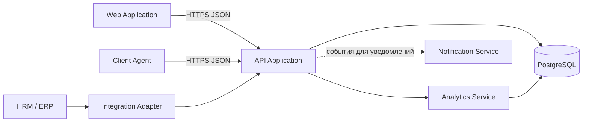

# Архитектура

Источники: [[ЛР4 — извлечённый текст]] §3; [[ЛР5 — извлечённый текст]] §1, страницы PDF 2–7. Ниже — реконструкция по тексту, а не подтверждённая схема работающей системы.

**Ограничение источника:** на страницах PDF 3–6 видны подписи рисунков 1–4, но сами C4-диаграммы отсутствуют в видимом содержимом. Просмотр рендеров подтвердил пустые области. Атрибуты и методы классов не восстанавливаем по предположению.

## Контекст C4

WorkPulse взаимодействует с сотрудником, HR, руководителем подразделения, топ-менеджментом, ИБ/compliance и администратором. Внешняя HRM/ERP поставляет сотрудников, подразделения, должности и оргструктуру. См. [[03 Роли и доступ]].

## Семь контейнеров ЛР5

| Контейнер | Ответственность |
|---|---|
| Web Application | Политики, журнал, отчёты, карточки, аналитика |
| Client Agent | Сбор событий на рабочей станции |
| API Application | REST API, бизнес-логика, доступ и работа с данными |
| Analytics Service | Классификация, простои, нарушения, KPI |
| Notification Service | Уведомления о нарушениях и технических событиях |
| Integration Adapter | Обмен кадровыми данными с HRM/ERP |
| Database | Централизованное хранение в PostgreSQL |

Схема показывает смысловые потоки, восстановленные из описания. Точные направления вызовов Integration Adapter и Notification Service, контракты API, очереди, независимость развёртывания и владение таблицами не специфицированы. C4-контейнер не обязательно Docker-контейнер.

## Компоненты Analytics Service

1. Activity Event Receiver — приём событий от API.
2. Work Session Processor — обработка сессий и обеда.
3. Activity Classification Service — категории активности.
4. Idle Detection Service — простои.
5. Violation Detection Service — нарушения.
6. KPI Calculation Service — расчёт показателей.
7. Report Data Provider — данные отчётов и дашбордов.
8. Monitoring Policy Provider — правила, графики и справочники.
9. Analytics Repository — сохранение результатов в БД.

## Уровень кода

Перечислены ViolationDetectionService, IdleDetectionService, ActivityClassificationService, MonitoringPolicy, WorkSession, ActivityEvent, ViolationRecord, KpiMetric и ViolationRepository. WorkSession содержит события ActivityEvent; ViolationDetectionService применяет MonitoringPolicy и формирует ViolationRecord, который сохраняет ViolationRepository. Подробности полей, сигнатур и кардинальностей отсутствуют.

## Эволюция описания

ЛР1 группирует систему в Agent / Server / Admin Web; ЛР4 выделяет десять функциональных модулей; ЛР5 раскрывает техническую модель из семи контейнеров. Это разные уровни детализации, а не само по себе противоречие. Число независимо запускаемых сервисов будущего MVP ещё не согласовано.

![[Источники/ЛР4-иллюстрации/image2.jpeg]]

Связи: [[09 Технологический стек]], [[10 Данные и термины]], [[11 Аналитика и KPI]], [[06 Требования и сценарии]].
