# Физическая ER-диаграмма

Сгенерирована из фактических столбцов и FK PostgreSQL. Составные ключи и CHECK полностью перечислены в словаре.

```mermaid
erDiagram
    activity_events {
        uuid organization_id PK
        uuid id PK
        uuid employee_id
        uuid device_id
        uuid session_id
        uuid client_event_id
        text event_type
        timestamptz occurred_at
        timestamptz received_at
        uuid resource_id
    }
    activity_intervals {
        uuid organization_id PK
        uuid id PK
        uuid run_id
        uuid session_id
        text category
        timestamptz started_at
        timestamptz ended_at
    }
    analytics_runs {
        uuid organization_id PK
        uuid id PK
        timestamptz period_start
        timestamptz period_end
        text algorithm_version
        text status
        timestamptz created_at
        timestamptz completed_at
    }
    audit_log {
        uuid organization_id PK
        uuid id PK
        uuid actor_id
        text table_name
        text operation
        uuid entity_id
        timestamptz occurred_at
        jsonb before_data
        jsonb after_data
    }
    classification_rules {
        uuid organization_id PK
        uuid id PK
        uuid policy_version_id
        uuid resource_id
        text category
    }
    departments {
        uuid organization_id PK
        uuid id PK
        text code
        text name
    }
    devices {
        uuid organization_id PK
        uuid id PK
        uuid employee_id
        text name
        text platform
        timestamptz registered_at
        timestamptz retired_at
    }
    employee_external_ids {
        uuid organization_id PK
        uuid connection_id PK
        uuid employee_id PK
        text external_id
    }
    employees {
        uuid organization_id PK
        uuid id PK
        uuid department_id
        text employee_number
        text full_name
        text position_name
        date hired_on
        date terminated_on
    }
    integration_connections {
        uuid organization_id PK
        uuid id PK
        text provider
        text name
        text secret_reference
        bool enabled
    }
    integration_jobs {
        uuid organization_id PK
        uuid id PK
        uuid connection_id
        text status
        timestamptz created_at
        timestamptz finished_at
    }
    interval_sources {
        uuid organization_id PK
        uuid interval_id PK
        uuid event_id PK
    }
    monitoring_policies {
        uuid organization_id PK
        uuid id PK
        text name
        bool archived
    }
    notifications {
        uuid organization_id PK
        uuid id PK
        uuid recipient_id
        uuid violation_id
        text channel
        text status
        timestamptz created_at
        timestamptz delivered_at
    }
    organizations {
        uuid id PK
        text slug
        text name
        text time_zone
        int4 retention_days
        timestamptz created_at
    }
    policy_assignments {
        uuid organization_id PK
        uuid id PK
        uuid policy_version_id
        text scope
        uuid department_id
        uuid employee_id
        timestamptz valid_from
        timestamptz valid_until
    }
    policy_versions {
        uuid organization_id PK
        uuid id PK
        uuid policy_id
        int4 version_number
        int4 idle_limit_seconds
        int4 non_target_limit_seconds
        int4 lunch_limit_seconds
        text time_zone
        timestamptz published_at
    }
    report_exports {
        uuid organization_id PK
        uuid id PK
        uuid requested_by
        uuid run_id
        text format
        text status
        text artifact_reference
        timestamptz created_at
    }
    resources {
        uuid organization_id PK
        uuid id PK
        text kind
        text identifier
        text display_name
    }
    role_assignments {
        uuid organization_id PK
        uuid id PK
        uuid user_id
        text role_code
        text scope
        uuid department_id
    }
    roles {
        text code PK
        text name
    }
    schedule_days {
        uuid organization_id PK
        uuid id PK
        uuid policy_version_id
        int2 iso_weekday
        time starts_at
        time ends_at
        bool ends_next_day
    }
    session_breaks {
        uuid organization_id PK
        uuid id PK
        uuid session_id
        text kind
        text source
        timestamptz started_at
        timestamptz ended_at
    }
    user_accounts {
        uuid organization_id PK
        uuid id PK
        uuid employee_id
        text email
        bool is_active
        text external_subject
    }
    violation_comments {
        uuid organization_id PK
        uuid id PK
        uuid violation_id
        uuid author_id
        text body
        timestamptz created_at
    }
    violations {
        uuid organization_id PK
        uuid id PK
        uuid employee_id
        uuid session_id
        text kind
        timestamptz detected_at
        timestamptz started_at
        timestamptz ended_at
        text status
        text deduplication_key
        uuid reviewed_by
    }
    work_sessions {
        uuid organization_id PK
        uuid id PK
        uuid employee_id
        uuid department_id
        uuid policy_version_id
        timestamptz started_at
        timestamptz ended_at
        text end_reason
    }
    activity_events ||--o{ interval_sources : "organization_id, event_id"
    activity_intervals ||--o{ interval_sources : "organization_id, interval_id"
    analytics_runs ||--o{ activity_intervals : "organization_id, run_id"
    analytics_runs ||--o{ report_exports : "organization_id, run_id"
    departments ||--o{ employees : "organization_id, department_id"
    departments |o--o{ policy_assignments : "organization_id, department_id"
    departments |o--o{ role_assignments : "organization_id, department_id"
    departments ||--o{ work_sessions : "organization_id, department_id"
    devices ||--o{ activity_events : "organization_id, employee_id, device_id"
    employees ||--o{ devices : "organization_id, employee_id"
    employees ||--o{ employee_external_ids : "organization_id, employee_id"
    employees |o--o{ policy_assignments : "organization_id, employee_id"
    employees |o--o{ user_accounts : "organization_id, employee_id"
    employees ||--o{ work_sessions : "organization_id, employee_id"
    integration_connections ||--o{ employee_external_ids : "organization_id, connection_id"
    integration_connections ||--o{ integration_jobs : "organization_id, connection_id"
    monitoring_policies ||--o{ policy_versions : "organization_id, policy_id"
    organizations ||--o{ activity_events : "organization_id"
    organizations ||--o{ activity_intervals : "organization_id"
    organizations ||--o{ analytics_runs : "organization_id"
    organizations ||--o{ audit_log : "organization_id"
    organizations ||--o{ classification_rules : "organization_id"
    organizations ||--o{ departments : "organization_id"
    organizations ||--o{ devices : "organization_id"
    organizations ||--o{ employee_external_ids : "organization_id"
    organizations ||--o{ employees : "organization_id"
    organizations ||--o{ integration_connections : "organization_id"
    organizations ||--o{ integration_jobs : "organization_id"
    organizations ||--o{ interval_sources : "organization_id"
    organizations ||--o{ monitoring_policies : "organization_id"
    organizations ||--o{ notifications : "organization_id"
    organizations ||--o{ policy_assignments : "organization_id"
    organizations ||--o{ policy_versions : "organization_id"
    organizations ||--o{ report_exports : "organization_id"
    organizations ||--o{ resources : "organization_id"
    organizations ||--o{ role_assignments : "organization_id"
    organizations ||--o{ schedule_days : "organization_id"
    organizations ||--o{ session_breaks : "organization_id"
    organizations ||--o{ user_accounts : "organization_id"
    organizations ||--o{ violation_comments : "organization_id"
    organizations ||--o{ violations : "organization_id"
    organizations ||--o{ work_sessions : "organization_id"
    policy_versions ||--o{ classification_rules : "organization_id, policy_version_id"
    policy_versions ||--o{ policy_assignments : "organization_id, policy_version_id"
    policy_versions ||--o{ schedule_days : "organization_id, policy_version_id"
    policy_versions ||--o{ work_sessions : "organization_id, policy_version_id"
    resources |o--o{ activity_events : "organization_id, resource_id"
    resources ||--o{ classification_rules : "organization_id, resource_id"
    roles ||--o{ role_assignments : "role_code"
    user_accounts |o--o{ audit_log : "organization_id, actor_id"
    user_accounts ||--o{ notifications : "organization_id, recipient_id"
    user_accounts ||--o{ report_exports : "organization_id, requested_by"
    user_accounts ||--o{ role_assignments : "organization_id, user_id"
    user_accounts ||--o{ violation_comments : "organization_id, author_id"
    user_accounts |o--o{ violations : "organization_id, reviewed_by"
    violations |o--o{ notifications : "organization_id, violation_id"
    violations ||--o{ violation_comments : "organization_id, violation_id"
    work_sessions |o--o{ activity_events : "organization_id, employee_id, session_id"
    work_sessions ||--o{ activity_intervals : "organization_id, session_id"
    work_sessions ||--o{ session_breaks : "organization_id, session_id"
    work_sessions ||--o{ violations : "organization_id, employee_id, session_id"
```

Отдельные UNIQUE (например, сотрудник ↔ учётная запись и один обед) уточняют общую кратность FK; см. словарь.
