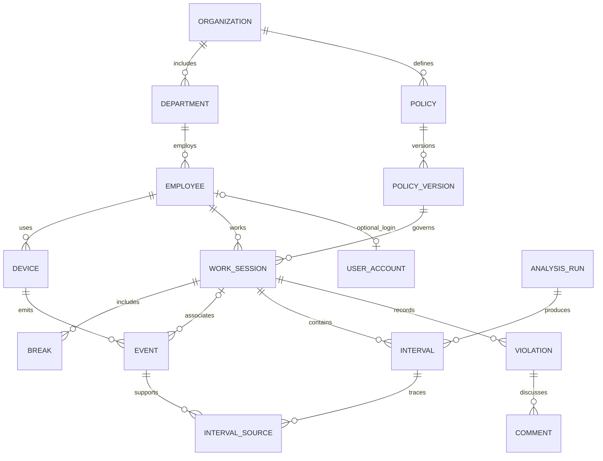

# Модель хранения WorkPulse

Основание: материалы ЛР1–5, UC1–UC8 / 32 FR и методичка ЛР7. Пользователь 12.10.2026 выбрал SaaS с несколькими организациями. Ниже зафиксированы решения реализации слоя хранения; они не превращают неоднозначные бизнес-правила в утверждённые требования.

## Концептуальный уровень

Организация объединяет подразделения, сотрудников, учётные записи, устройства и политики. Учётная запись и сотрудник — разные сущности: техническая учётная запись может не иметь сотрудника, сотрудник может не иметь входа в UI. Один сотрудник имеет несколько устройств. Сессия принадлежит сотруднику, а не устройству; перерывы относятся к сессии. Поэтому обед учитывается один раз на смену, а временные интервалы анализа не удваиваются из-за нескольких ПК.

Политика имеет версии, версия содержит расписание и правила классификации приложений/доменов. Назначение связывает опубликованную версию с организацией, подразделением или сотрудником на период. Сессия ссылается на конкретную опубликованную версию, поэтому история не зависит от последующего редактирования политики.

Исходное событие относится к устройству и сотруднику; сессия может быть неизвестна при офлайн-приёме. События имеют отдельно время возникновения и время получения. Анализ создаёт самостоятельный запуск с версией алгоритма и периодом, затем непересекающиеся интервалы и связи с исходными событиями. Пересчёт создаёт новый запуск, а не заменяет первичные события. Неизвестные промежутки представлены `unknown` и не означают доказанный простой.

Нарушение относится к сотруднику и сессии; версия политики доступна через сессию. Комментарии относятся к нарушению и автору. Уведомления, задания экспорта и интеграций — записи жизненного цикла будущих операций, не выполняемые внешние запросы.

## Логический уровень и 3НФ

Краткая концептуальная схема (полные атрибуты и FK — в физической ER-диаграмме):

Tenant-сущности имеют составной первичный ключ `(organization_id,id)`. UUID уникален в пространстве организации; отдельного глобального UNIQUE(id) нет. Внешние ключи включают tenant, поэтому ссылка на объект другой организации невозможна даже при административном обходе RLS. Таблицы связей используют соответствующие составные ключи (`interval_sources`, `employee_external_ids`); общие роли имеют ключ `code`.

1НФ: в столбцах нет списков сотрудников, устройств или ролей; повторяющиеся связи вынесены в отдельные таблицы. `full_name` и `identifier` рассматриваются как единичные значения домена, поскольку разбор ФИО/имени ресурса не требуется.

2НФ: атрибуты строки tenant-сущности зависят от всего ключа `(organization_id,id)`. Имя организации хранится только в `organizations`, название отдела — в `departments`, название роли — в `roles`. Таблицы связей не дублируют атрибуты участников.

3НФ: сведения о политике отделены от версии, параметры версии не копируются в сессию, название сотрудника не хранится в событиях/нарушениях, комментарии/уведомления отделены от нарушений. Производные проценты KPI, суммы времени и названия ресурсов не копируются в первичные журналы.

Осознанные физические исключения: `employee_id` в событии/нарушении необходим для составного ограничения «устройство/сессия принадлежит этому сотруднику», хотя при заданном ключе устройства/сессии он выводим. `department_id` сессии — самостоятельный исторический факт отдела на начало смены, а не копия текущего отдела сотрудника. JSONB `before_data/after_data` в аудите — исторический снимок изменения, намеренная денормализация журнала. Таким образом, нормализованное бизнес-ядро приведено к 3НФ, а эти исключения перечислены явно; неверно заявлять строгую 3НФ абсолютно каждой физической таблицы.

## Физический уровень

UUID — идентификаторы; `timestamptz` — временные точки (хранение абсолютного момента, UTC в тестах); `time` + ISO-день 1–7 — локальное расписание; `date` — кадровые даты; `integer` — лимиты в секундах. IANA timezone проверяется по `pg_timezone_names`. Ночная смена может пересекать полночь; у расписания есть `ends_next_day`.

CHECK задаёт диапазоны/состояния, составные FK — связи, UNIQUE — бизнес-идентификаторы и дедупликацию. GiST EXCLUDE с `btree_gist` запрещает пересечение сессий сотрудника, перерывов смены, интервалов одного анализа и назначений одного уровня. Диапазоны полуоткрытые `[start,end)`: смежные интервалы разрешены, событие в точке окончания сессии относится уже к следующему интервалу. NULL-конец означает открытый интервал. Partial UNIQUE обеспечивает один обед за сессию, включая уже завершённый обед.

Триггеры проверяют границы дочерних временных записей и изменение границ родителя, блокируют изменение опубликованного содержимого, проверяют источники интервала и автоматически пишут аудит изменений политик/ролей. Временные проверки блокируют родительскую строку для согласования конкурентных изменений. Полноценный нагрузочный/конкурентный стресс-тест пока не выполнялся.

Индексы включают tenant в начало ключа: события сотрудника по времени, нарушения по статусу/времени, очередь уведомлений, журнал аудита. Дополнительные FK-индексы создаются V006. Партиционирование и TTL-процедуры пока не вводятся без объёма данных и утверждённых сроков хранения.

## Покрытие требований хранилищем

| Сценарий | Таблицы | Что остаётся за приложением |
|---|---|---|
| UC1 / FR1-1–1-4: политики | monitoring_policies, policy_versions, schedule_days, resources, classification_rules, policy_assignments | UI, приоритет назначений, бизнес-валидация |
| UC2 / FR2-1–2-4: сессии и офлайн | work_sessions, devices, activity_events | Приоритет сигналов начала/окончания, буфер агента и синхронизация |
| UC3 / FR3-1–3-4: обед | session_breaks, policy_versions, violations | Запуск обеда и расчёт превышения |
| UC4 / FR4-1–4-4: активность | activity_events, resources, analytics_runs, activity_intervals, interval_sources | Сбор, объединение нескольких устройств, классификация |
| UC5 / FR5-1–5-4: нарушения | violations, work_sessions, policy_versions | Правила обнаружения и пороги |
| UC6 / FR6-1–6-4: журнал | violations, violation_comments, employees, departments | API-фильтры, экран и полномочия |
| UC7 / FR7-1–7-4: отчёты | analytics_runs, activity_intervals, report_exports | Согласование формул KPI, агрегации, PDF/XLSX |
| UC8 / FR8-1–8-4: управление | Те же факты анализа + departments/employees | Сравнения периодов, дашборды и принятие решений |
| Роли, аудит, интеграции | user_accounts, roles, role_assignments, audit_log, notifications, integration_connections, employee_external_ids, integration_jobs | Аутентификация/RBAC, доставка, контракты интеграций |

## Ограничения и открытые решения

- RLS реализует границу организаций. Доступ HR/руководителя/сотрудника внутри организации проверит API; матрица ещё не утверждена.
- Событие без `session_id` можно хранить; его связь с интервалом определяет анализ. Идентичность/время/сессия принятого события неизменяемы, обогащение выполняется через `interval_sources`.
- Приоритет политики employee > department > organization — возможный алгоритм, но в БД пока хранятся назначения, алгоритм выбора не утверждается.
- KPI не рассчитываются заранее: формулы пока не утверждены. Хранятся классифицированные интервалы с версией алгоритма.
- Срок хранения `retention_days` необязателен, числовое значение не выдумано. Автоматическое удаление не реализовано; связи используют RESTRICT/NO ACTION, не массовый CASCADE.
- Нет снимков экрана, текстов нажатий, переписки, заголовков страниц или полных URL. Ресурс сайта — домен; интеграция содержит ссылку на секрет, не токен.
- Одна учётная запись относится к одной организации. У одного человека при участии в нескольких организациях будут отдельные tenant-записи; единый внешний subject возможен позже.
- Модель расписания содержит один интервал смены на ISO-день; раздельные смены/праздничный календарь потребуют следующей миграции.
- Снимки аудита только политик и назначений ролей; аутентификация, доступ к данным и экспорт должны логироваться API отдельно.

Это техническая основа ЛР7. Формальный отчёт и его оформление по СТП готовятся отдельной задачей на основе этих файлов и фактических проверок.
